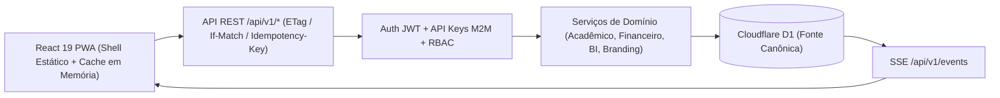

# Arquitetura do ERPITB — Autoridade Online REST v1

## 1. Visão Geral e Limites de Confiança

O **ERPITB** opera sob o paradigma **100% online orientado por API REST versionada (`/api/v1/*`)**, onde o backend serverless (**Cloudflare Workers**) e o banco relacional **Cloudflare D1 (SQLite)** constituem a única autoridade canônica para persistência, controle de concorrência, cálculos de negócio e autorização (RBAC/escopos).

O cliente Web PWA (**React 19 + TypeScript + Vite**) mantém o Service Worker exclusivamente para instalação e cache de ativos estáticos do shell (HTML, CSS, JS, ícones), sem utilizar IndexedDB como banco de dados operacional permanente. Qualquer fila legada eventualmente presente em dispositivos antigos é drenada de forma segura para `/api/v1/migration/drain` antes da limpeza local.



---

## 2. Contratos da API `/api/v1/*`, Concorrência e Idempotência

### 2.1. Endpoints Versionados (`/api/v1/*` e `/v1/*`)
- **Especificação OpenAPI 3.0**: `GET /api/v1/openapi.json`
- **Eventos em Tempo Real (SSE)**: `GET /api/v1/events` (suporta `Last-Event-ID` e `?since=` para replay de `system_events` persistidos no D1: `entity_changed`, `branding_updated`, `session_revoked`, `ping`).
- **Acadêmico e Catálogo**:
  - `GET/POST/PATCH /api/v1/students`, `POST /api/v1/students/:id/lock` (trancamento de matrícula preservando histórico).
  - `GET/POST/PATCH /api/v1/classes`, `GET/POST /api/v1/classes/:id/sessions` (sessões de aula ministradas canônicas em `class_sessions`).
  - `GET/POST /api/v1/attendance` (registro de chamada com geração automática de sessão em `class_sessions`).
  - `GET/POST/PATCH/DELETE /api/v1/grade-tables`, `/api/v1/grade-items`, `GET/POST /api/v1/student-grades`.
  - `GET/POST/PATCH /api/v1/replacements`, `POST /api/v1/replacements/:id/complete` (conclusão atômica da reposição + atualização de presença para `RC`).
- **Domínio Financeiro**:
  - `GET /api/v1/finance/summary`
  - `GET/POST/PATCH /api/v1/finance/fees` (geração individual ou em lote por turma/competência).
  - `POST /api/v1/finance/fees/:id/pay` (baixa total ou parcial em centavos inteiros + lançamento vinculado no caixa).
  - `POST /api/v1/finance/fees/:id/reverse` (estorno compensatório sem exclusão física).
  - `GET/POST /api/v1/finance/cash`, `POST /api/v1/finance/cash/:id/reverse`.
  - `GET/PUT /api/v1/finance/contacts/:studentId` (dados do responsável financeiro cifrados com AES-256-GCM).
- **Analytics, B.I. e Relatórios Server-Side**:
  - `GET /api/v1/analytics` (métricas acadêmicas, frequência, risco, reposições e financeiro pré-calculadas no servidor).
  - `GET /api/v1/reports` (`attendance`, `grades`, `classBoletim`, `studentBoletim`, `courses`, `SystemLogs`, `fees`, `financial`, `cash`).
- **Administração, Branding e Chaves M2M**:
  - `GET /api/v1/branding`, `PUT /api/v1/admin/branding`, `POST /api/v1/admin/branding/reset`.
  - `GET/POST /api/v1/admin/api-keys`, `DELETE /api/v1/admin/api-keys/:id`, `POST /api/v1/admin/api-keys/:id/rotate`.

### 2.2. Controle de Concorrência Otimista (`ETag` / `If-Match`)
- Entidades mutáveis possuem coluna `version` monotônica e retornam o cabeçalho `ETag: W/"<version>"`.
- Mutações (`PUT`, `PATCH`, `POST` de atualização) aceitam `If-Match: W/"<version>"` ou `expectedVersion` no payload.
- Em caso de divergência de versão, o servidor rejeita a escrita com **HTTP 409 Conflict** (`code: "CONCURRENCY_CONFLICT"`) e retorna o estado atual do servidor (`currentVersion`, `serverState`).

### 2.3. Idempotência (`x-idempotency-key`)
- Operações críticas (chamada, pagamentos, lançamentos de caixa, estornos, geração de mensalidades) suportam o cabeçalho `x-idempotency-key`.
- A tabela `idempotency_keys` utiliza chave primária composta `(user_id, key)` com hash SHA-256 do payload (`request_hash`).
- Repetições com o mesmo payload retornam a resposta original com `"duplicate": true`; reutilização da mesma chave com payload distinto retorna **HTTP 422** (`IDEMPOTENCY_KEY_REUSED_WITH_DIFFERENT_PAYLOAD`).

---

## 3. Segurança, Criptografia (LGPD) e Matriz RBAC

### 3.1. Criptografia e Autenticação
- **Senhas**: `PBKDF2-HMAC-SHA256` (100.000 iterações via Web Crypto nativo) com upgrade transparente de hashes legados Argon2id no login.
- **Dados Sensíveis (LGPD)**: CPF e telefone/contato de alunos (`students`) e de responsáveis financeiros (`financial_contacts`) são cifrados em repouso no D1 com **AES-256-GCM** e IV aleatório único por campo (`DATA_ENCRYPTION_KEY`).
- **Chaves de API M2M (`api_keys`)**: Geradas com alta entropia (`erpitb_live_...`), exibidas uma única vez na criação/rotação e armazenadas exclusivamente como hash SHA-256 no D1. Chaves sem o escopo explícito `students:pii` recebem dados pessoais mascarados/redigidos.

### 3.2. Matriz RBAC de Menor Privilégio

| Papel | Acadêmico (Chamada, Notas, Boletim) | Catálogo (Cursos, Turmas, Alunos) | Financeiro (Mensalidades, Caixa, Estornos) | Admin (Usuários, Branding, API Keys) |
| :--- | :---: | :---: | :---: | :---: |
| **`admin`** | Leitura e Escrita total | Leitura e Escrita total | Leitura e Escrita total | Leitura e Escrita total |
| **`pedagogico`** | Leitura e Escrita total | Leitura e Escrita total | Leitura gerencial (sem operar caixa) | Sem acesso (`403`) |
| **`professor`** | Leitura e Escrita nas turmas atribuídas | Leitura das turmas atribuídas | Sem acesso (`403`) | Sem acesso (`403`) |
| **`financeiro`** | **Bloqueado (`403`)** (Zero acesso a notas/chamada/observações) | Leitura de matrícula/identificação para cobrança | **Leitura e Escrita total** | Sem acesso (`403`) |

---

## 4. Regras de Negócio no Servidor

1. **Sessões de Aula (`class_sessions`) vs. Registros de Presença (`attendance_records`)**:
   - Cada aula ministrada gera um registro canônico em `class_sessions (class_id, date)`. O total de aulas ministradas da turma é desacoplado da quantidade de linhas individuais de presença.
2. **Trancamento de Matrícula (`status = 'trancada'`)**:
   - Retira o aluno das folhas de chamada futuras, mantendo intacto todo o histórico de presenças, notas e mensalidades anteriores.
3. **Integridade Contábil do Caixa e Mensalidades**:
   - Todos os valores monetários são processados e armazenados em **centavos inteiros** (`amount_cents`, `paid_amount_cents`).
   - Baixas de mensalidades geram automaticamente entradas vinculadas em `cash_transactions`.
   - Não há exclusão física (`DELETE`) de lançamentos financeiros: correções exigem justificativa obrigatória e geram lançamentos compensatórios de estorno (`is_reversal = 1`, `reversed_from_id`) registrados em `audit_logs`.
4. **Identidade Visual & Impressão A4**:
   - A cor de destaque configurada em `/admin/branding` passa por validação de luminância relativa **WCAG 2.1 AA** no servidor e injeta tokens CSS (`--brand-accent`, `--brand-accent-text`, `--brand-accent-subtle`).
   - Relatórios suportam orientação específica (`.print-portrait` e `.print-landscape`) e marca d'água institucional (`.print-watermark`).

---

## 5. Guia de Implantação, Migração e Rollback

1. **Aplicar Migrações D1**:
   ```bash
   cd backend
   npx wrangler d1 execute erpitb --local --file=src/schema.sql
   # Ou aplicar migrações incrementais:
   npx wrangler d1 migrations apply erpitb --local
   ```
2. **Verificação Pré-Deploy**:
   ```bash
   cd backend && npm run typecheck && npm test
   cd ../web && npx tsc -b && npm test && npm run build
   ```
3. **Drenagem Segura de Clientes Legados**:
   - Ao abrir a nova versão, `drainLegacyClientStorage` inspeciona bancos IndexedDB antigos (`erpitb-pwa`, `frequencia-itb-pwa`), envia qualquer operação pendente para `POST /api/v1/migration/drain` e só limpa a fila local após confirmação HTTP 200 do servidor.
4. **Rollback Seguro**:
   - As migrações `0012` e `0013` são estritamente aditivas (novas tabelas e colunas com valores padrão compatíveis), preservando compatibilidade com os dados existentes no D1.
